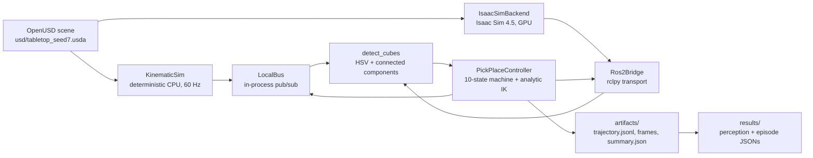
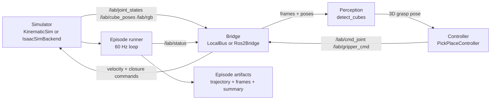

# IsaacLabStarterLab

IsaacLabStarterLab is a reproducible, learner-tested teaching lab that takes a
developer from a clean Linux machine to a working tabletop pick-and-place robot
workflow: a generated OpenUSD scene, a ROS 2 perception/control stack, a seeded
domain-randomization dataset, knowledge checks, and a self-check grader that
validates the real output artifacts. The repository is the deliverable: the lab
guide, the runnable example, committed reference frames, and CI that fails when
the guide rots. It is for robotics/vision developers who want to learn the
OpenUSD + Isaac Sim + ROS 2 stack without hiding the geometry behind a black box,
and for instructors who need a lab they can grade reproducibly. The CPU track
runs anywhere; the GPU track is the same code against Isaac Sim 4.5.

## Quickstart

Five commands from a clone to a graded `labcheck all` on the CPU track:

```bash
git clone https://github.com/AbhiramCommits/IsaacLabStarterLab.git IsaacLabStarterLab && cd IsaacLabStarterLab
python3.11 -m venv .venv && source .venv/bin/activate
make install
make lab-headless
labcheck all
```

`make lab-headless` runs scene generation → 200-seed domain randomisation → a
seed-7 episode → perception evaluation → a 100-episode sweep → `labcheck`, and
writes per-stage timings to `results/timings.json`.

The GPU Isaac Sim track (NVIDIA host only; not executed in this build):

```bash
docker build -f docker/Dockerfile.isaac -t isaac-starter-lab:gpu .
docker run --rm -it --gpus all --network host \
  -e ACCEPT_EULA=Y -e PRIVACY_CONSENT=Y -e LAB_BACKEND=isaac -e LAB_BRIDGE=ros2 \
  -v "$HOME/.cache/ov:/root/.cache/ov" -v "$HOME/.cache/pip:/root/.cache/pip" \
  -v "$HOME/.cache/nvidia:/root/.cache/nvidia" \
  -v "$HOME/.local/share/ov:/root/.local/share/ov" \
  isaac-starter-lab:gpu
```

## Architecture

The lab has one message schema and two interchangeable runtimes. Learner code
talks only to `Bridge` topics and schema objects, so the **same** perception and
controller modules run against:

- `kinematic` + `localbus`: a deterministic CPU simulator and an in-process
  publish/subscribe bus, used for every measured result, every test, and CI.
- `isaac` + `ros2`: `IsaacSimBackend` around `isaacsim.SimulationApp` and a
  `Ros2Bridge` using real `sensor_msgs` / `std_msgs` types.

Selection is `--backend`/`LAB_BACKEND` and `--bridge`/`LAB_BRIDGE`. That seam is
the point of the lab: the learner's detector and state machine do not import a
simulator or a transport.





### Modules

| Module | Job |
| --- | --- |
| `config.py` | Frozen dataclasses for camera intrinsics, scene AABBs/palette and arm geometry; `LAB_SEED = 7`. |
| `cli.py` | Six argparse entry points (`lab-scene`, `lab-dr`, `lab-episode`, `lab-eval`, `labcheck`, `lab-quiz`) plus module dispatch. |
| `ranges.py` | Inclusive seed-range parsing for datasets and sweeps. |
| `scene/build_scene.py` | Real `pxr` stage: table, bin walls, rigid-body cubes, 5-DOF arm chain and revolute joints, camera, dome light; seeded rejection sampling. |
| `scene/hashing.py` | sha256 over flattened, comment-stripped `.usda` text with floats canonicalised to 9 decimals (cross-platform pin). |
| `scene/pipeline.py` | `lab-scene` implementation: export `.usda`, write meta JSON, optional PNG render. |
| `sim/schema.py` | Single source of truth for the six messages and topic names on both tracks. |
| `sim/kinematics.py` | Analytic forward and inverse kinematics for the 5-DOF arm (hand-computed poses in tests). |
| `sim/kinematic.py` | Fixed 1/60 s deterministic simulator: velocity tracking, gripper attach/release, drop settling, bin detection. |
| `sim/isaac_backend.py` | Lazily imported Isaac Sim 4.5 adapter; same schema, ROS 2 bridge, camera and stage; actionable `IsaacUnavailableError`. |
| `sim/factory.py` | `make_backend()` / `LAB_BACKEND` selection. |
| `render/pinhole.py` | NumPy/Pillow ray caster from the exact USD camera intrinsics; `project_point` and `backproject_to_plane`; stands in for RTX. |
| `bridge/base.py` | `Bridge` protocol (`publish`, `subscribe`, `spin_once`, `close`). |
| `bridge/localbus.py` | Dependency-free FIFO in-process bus that round-trips every message through the schema. |
| `bridge/ros2_bridge.py` | `rclpy` bridge: `sensor_msgs/Image`, `sensor_msgs/JointState`, `std_msgs/String`; guarded import with ROS setup hint. |
| `perception.py` | `detect_cubes`: RGB→HSV threshold, 8-connected components, pixel centroid, back-projection to the table plane. |
| `controller.py` | Explicit ten-state pick-and-place machine with analytic IK, per-state timeouts and stable failure codes. |
| `episode.py` | 60 Hz backend↔bridge loop; writes `trajectory.jsonl`, `summary.json`, start/final frames. |
| `datasets/dr.py` | Seeded DR generator: pose/colour/light/camera-yaw/table albedo, per-file and dataset hashes. |
| `evaluation.py` | Perception pixel/3D error, recall/precision; 100-seed episode success/cycle-time sweep; writes `results/`. |
| `grading.py` | `labcheck` artifact grader for env, ex1–ex4/all, with PASS/FAIL table, hints and non-zero exit. |
| `quiz.py` | Knowledge-check grading against sha256-only answer bank; writes quiz result JSON. |
| `isaac_lab/pick_place_env_cfg.py` | Importable `ManagerBasedRLEnvCfg`-style dataclasses for the GPU Isaac Lab task; validation tested on CPU. |
| `ros2_ws/src/starter_lab/` | Real ament_python package; `perception_node` and `controller_node` are thin wrappers around the shared modules. |

## Repository map

```text
src/isaac_starter_lab/   package (scene, sim, render, bridge, lab logic, Isaac adapters)
ros2_ws/src/starter_lab/ ROS 2 ament_python wrappers
tests/                   unit + end-to-end + determinism tests
scripts/                 lab-headless, determinism, results, guide-command, Mermaid, demo
usd/                     canonical tabletop_seed7.usda, meta and EXPECTED_HASHES.json
datasets/dr/             manifest.json + four committed image/label samples (bulk gitignored)
lab/                     knowledge_checks.yaml and answers template
exercises/               starter stubs for the learner-written functions
solutions/               reference pointers (open only after the exercise)
docs/                    LAB_GUIDE, VERIFICATION, WALKTHROUGH, diagrams, reference images
demo/                    recorded walkthrough log and lab-rendered frames
learner-testing/         protocol, cold runs, issues, tester table
results/                 measured JSON + generated RESULTS.md
docker/                  CPU lab image and GPU Isaac Sim image
.github/                 CI workflow and lab-feedback issue form
```

## Reading order

- **Lab guide:** [`docs/LAB_GUIDE.md`](docs/LAB_GUIDE.md)
- **Knowledge checks:** [`lab/knowledge_checks.yaml`](lab/knowledge_checks.yaml)
  and `lab-quiz --answers my_answers.yaml`
- **Walkthrough:** [`docs/WALKTHROUGH.md`](docs/WALKTHROUGH.md) and `demo/walkthrough.log`
- **Diagrams:** [`docs/diagrams/`](docs/diagrams/)
- **Verification scope:** [`docs/VERIFICATION.md`](docs/VERIFICATION.md)

## Results

<!-- RESULTS:START -->
| Metric | Measured value |
| --- | --- |
| Scene hash (seed 7) | `af653ff61a3791440124a0af7067aaabe5a483f9084ef00370c6fe92c7abab40` |
| Scene prim count | 46 |
| DR dataset | 200 frames, hash `e112f454d426badab50614ce74e4dcb418ad770417a62d841bf30775f9b9b4dc` |
| Perception pixel error | mean 1.058 px, p95 3.577 px |
| Perception 3D error | mean 3.607 mm, p95 12.885 mm |
| Detection recall / precision | 100.00% / 100.00% |
| Episode success (100 seeds) | 100/100 (100.00%); failures: none |
| Cycle time | mean 5.165 s, p95 5.467 s |
| Per-stage timings | scene 0.06 s, dr 4.36 s, episode 0.33 s, perception_eval 11.20 s, episode_eval 30.16 s, labcheck 0.50 s |
| Determinism | 2 runs, 610 artifacts, hashes identical |
| Test suite | 145 tests, 0 failures, 88.20% statement coverage |
| CI jobs | test, lab, determinism, docker, gpu-isaac |
| Labcheck | PASS, 45 checks |
| Learner testing | 1 cold run, 2 issues filed, 2 fixed |

All values are read from the JSON files under `results/` and the committed dataset manifest by `scripts/collect_results.py`; the GPU track is not included.

<!-- RESULTS:END -->

The dataset hash in the table is a same-environment self-consistency hash: PNG
bytes and full-precision label floats can differ between platforms even when the
decoded pixels and metrics are identical. The scene hash is the cross-machine
pin; see the guide for both measured dataset values.

## Scope and verification

The CPU headless track has been run on a macOS arm64 host: the real `pxr` scene
builder and hash, the software renderer, the local bus, perception and the
controller, the 200-seed dataset, the 100-episode sweep, `labcheck`, the pytest
suite, and the Docker lab image under `linux/amd64` emulation. CI runs the test,
lab, determinism and Docker jobs on GitHub Actions.

The NVIDIA Isaac Sim app, the Isaac Lab environment, the `rclpy` transport and
the GPU Docker image are **GPU/ROS-gated and unexecuted**. They have import
guards, unit-tested dataclasses and a documented container, but no number in
this README comes from the GPU path. Details and the exact machine profile are
in [`docs/VERIFICATION.md`](docs/VERIFICATION.md).

## Learner testing

- Protocol: [`learner-testing/PROTOCOL.md`](learner-testing/PROTOCOL.md)
- Owner cold run: [`learner-testing/cold_runs/run_1.md`](learner-testing/cold_runs/run_1.md)
- Issues and fixes: [`learner-testing/issues/`](learner-testing/issues/)
- Tester table: [`learner-testing/TESTERS.md`](learner-testing/TESTERS.md)
- Change history: [`CHANGELOG.md`](CHANGELOG.md)

The repository owner is doing the cold reproduction run on their own machine
(fresh clone, fresh venv, README quickstart); external human testers are planned
and are listed as pending in `TESTERS.md` until real people complete a run.
