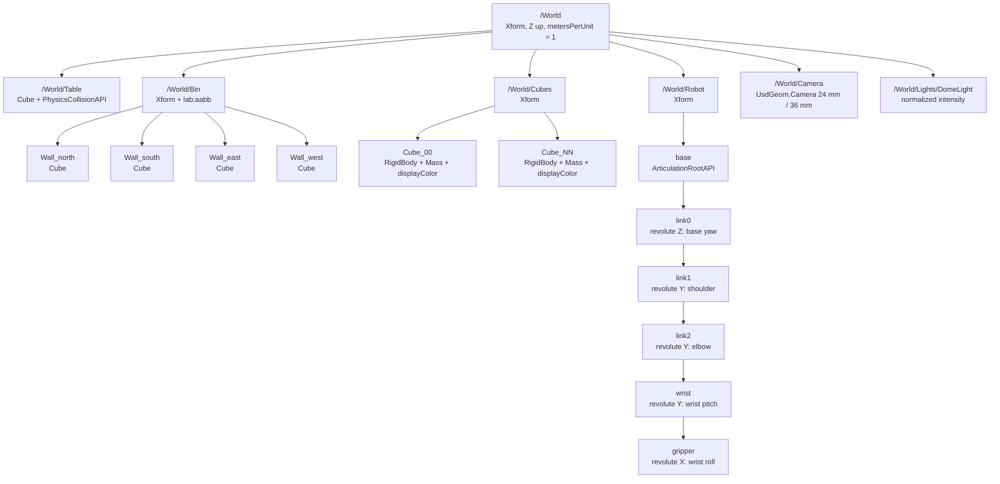
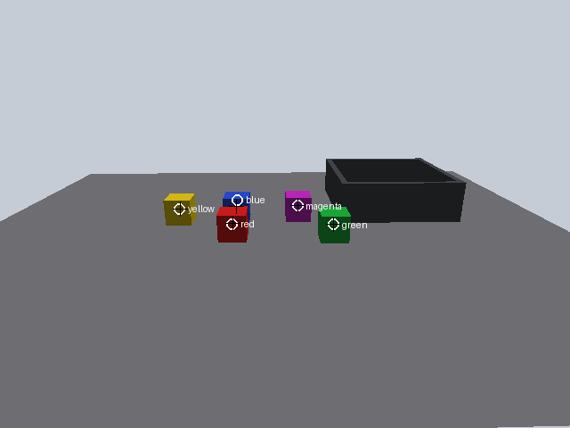
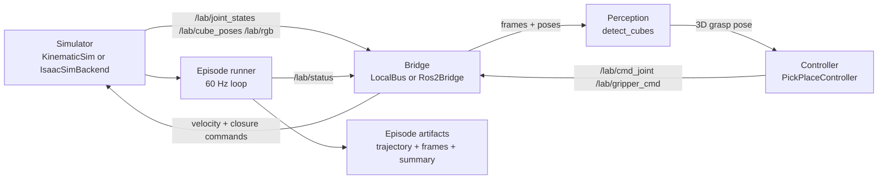
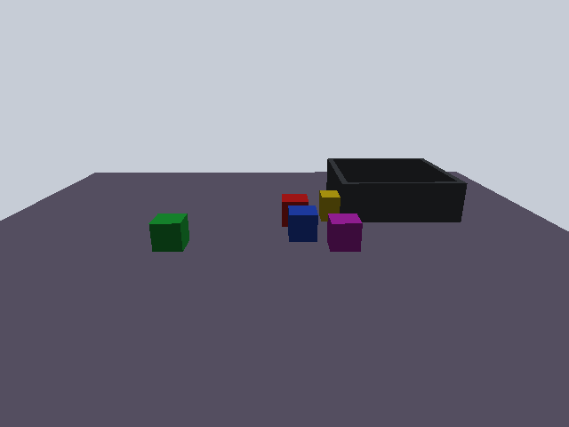
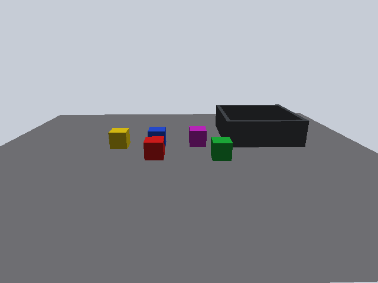

# IsaacLabStarterLab — hands-on tabletop pick-and-place

This lab takes you from a clean Linux machine to a working tabletop pick-and-place
workflow: you generate an OpenUSD scene, render it with the lab camera, write the
perception that finds a cube, drive a ten-state controller over a message bus,
generate a seeded domain-randomisation dataset, and grade every artifact with
`labcheck`.

The repository ships **two runtimes on one contract**:

| Track | Backend | Bridge | Hardware | Status in this repo |
| --- | --- | --- | --- | --- |
| CPU headless | `kinematic` | `localbus` | any laptop / CI | executed and measured |
| GPU Isaac Sim | `isaac` | `ros2` | NVIDIA RTX + Isaac Sim 4.5 | code path provided, GPU-gated |

Every number in the **Expected results** section was measured on the CPU track
and stored under `results/`. The GPU path has not been executed on the build
machine; see [`VERIFICATION.md`](VERIFICATION.md).

## What you will build

By the end you will have:

1. `artifacts/scene_seed7.usda` — a deterministic OpenUSD scene with a table, bin,
   five rigid-body cubes, a 5-DOF arm, a dome light and a physical camera.
2. `artifacts/ex2_frame.png` — a 640x480 frame rendered through the exact USD
   camera intrinsics.
3. A working `detect_cubes` that turns colour pixels into 3D grasp poses.
4. `artifacts/episodes/seed_7/` — a complete episode with `trajectory.jsonl`,
   `summary.json`, a start frame and a final frame.
5. `datasets/dr/` — 200 seeded domain-randomisation frames, labels and a manifest
   with per-file and dataset hashes.
6. `results/perception_eval.json`, `results/episode_sweep.json`,
   `results/labcheck.json` — measured evaluation output.

### Learning objectives

- Read and write OpenUSD prims, attributes, relationships and physics APIs with
  the real `pxr` Python API.
- Derive pinhole intrinsics from USD camera attributes and invert the projection
  onto a known plane.
- Hash a flattened stage reproducibly by removing non-scene metadata.
- Implement HSV thresholding, connected components and back-projection.
- Explain why seeded randomness is the difference between a demo and a benchmark.
- Implement and debug an explicit robot state machine with analytic IK.
- Move the same learner code between an in-process bus and ROS 2 without edits.
- Use artifact-based grading rather than "it looked fine on my machine".

### Time estimate

Plan **2.5–3.5 hours** for a first pass (reading, coding Exercise 2, running the
exercises). The measured compute time is much smaller; most of the time is
reading and writing the detector/controller.

| Command | Measured on the build machine |
| --- | --- |
| `make dr` (200 seeds) | 4.4 s |
| `lab-eval perception` (200 seeds) | 11.2 s |
| `lab-eval episodes` (100 seeds) | 30.2 s |
| `make lab-headless` (all stages) | 46.6 s |
| `pytest -q` (includes two full determinism runs) | 101.6 s |
| full `labcheck all` | 0.5 s |

## Prerequisites and version matrix

The lab targets Ubuntu 22.04 or 24.04. The CPU track also runs on macOS; the
GPU track requires a Linux NVIDIA host.

| Requirement | Version / value | CPU headless | GPU Isaac Sim | Notes |
| --- | --- | --- | --- | --- |
| OS | Ubuntu 22.04 LTS | required | required | 24.04 works; Isaac Sim 4.5 is validated on 22.04 |
| Python | 3.10, 3.11 or 3.12 | required | inside container | `pyproject.toml` rejects 3.13+ |
| `make` | GNU make | required | inside container | all short commands go through it |
| Git | any current release | required | required | the repo is a git repository |
| NVIDIA driver | ≥ 535.129.03 | — | required | Isaac Sim 4.5 requirement |
| CUDA | 12.x runtime bundled with the container | — | required | do not install a separate CUDA toolkit |
| GPU | NVIDIA RTX class | — | required | 16 GB VRAM recommended for this scene |
| ROS 2 | Humble (22.04) / Jazzy (24.04) | not required | required only for `LAB_BRIDGE=ros2` | the CPU track uses `localbus` |
| Docker | 24+ | optional | required by the documented image | CPU image is `linux/amd64` |
| NVIDIA Container Toolkit | current | — | required | exposes the GPU to Docker |
| Disk | 2 GB CPU / 40 GB GPU | 2 GB | 40 GB | Isaac Sim layers and caches are large |
| Display | none needed | headless | headless | the lab never opens a window |

The CPU track is deliberately dependency-free beyond the pinned Python wheels:
`usd-core`, NumPy, Pillow, PyYAML and Matplotlib. No ROS installation, no GPU and
no Isaac Sim are needed to complete Exercises 0–4.

## How this guide is tested

Bash blocks marked `<!-- test:run -->` are executed in order by
`scripts/extract_guide_commands.py` in CI; a stale command fails the build.
Environment bootstrap (creating the venv and installing wheels) is validated by
the owner's cold run in `learner-testing/cold_runs/` instead, because it is
host-specific. Every expected hash and threshold below is checked by `labcheck`
and by the test suite.

## Exercise 0 — environment and `labcheck env`

From the repository root (clone or copy it first):

```bash
cd IsaacLabStarterLab
python3.11 -m venv .venv
source .venv/bin/activate
make install
```

`make install` installs `requirements.lock.txt` (exact pins for `usd-core 25.11`,
`numpy 2.2.6`, `pillow 12.0.0`, `PyYAML 6.0.3`, `matplotlib 3.10.8`, plus the
dev tools) and then installs this package editable without changing the pins.

Now check the environment:

<!-- test:run -->
```bash
labcheck env
```

Expected: a PASS table ending in `RESULT: PASS`. If you see a FAIL, use the
`FIX:` line under it; the troubleshooting table at the end lists the errors this
build actually produced.

Docker alternative (no local venv; Linux containers via `linux/amd64`). There
are two distinct modes, and they are easy to confuse:

```bash
# One-shot: the image CMD runs scene -> DR -> episode -> eval -> labcheck.
docker build -f docker/Dockerfile.lab -t isaac-starter-lab:local .
docker run --rm isaac-starter-lab:local

# Guided shell: for following this guide exercise by exercise.
docker run --rm -it isaac-starter-lab:local bash
# inside the container the working directory is /lab (not IsaacLabStarterLab),
# the package is already installed, and `make` is available:
cd /lab
labcheck env
```

Do **not** create another venv or run `make install` inside the image; the
pinned environment is already installed. Inside the guided shell, replace
`cd IsaacLabStarterLab` in the exercise text with the container's `/lab`.
On Apple Silicon Docker emulates `linux/amd64` because `usd-core` ships x86_64
Linux wheels, so commands are correct but noticeably slower.

## Exercise 1 — generate and inspect the OpenUSD scene

The scene is built with the real `pxr` API from `SceneConfig` in
`src/isaac_starter_lab/config.py`. Cube placement uses
`numpy.random.default_rng(seed)`, rejection sampling and a bounded attempt count;
cubes are Chebyshev-separated so no two axis-aligned boxes overlap.

<!-- test:run -->
```bash
lab-scene --seed 7 --out artifacts/scene_seed7.usda --render artifacts/ex2_frame.png --force
```

Expected output includes:

```text
scene: .../artifacts/scene_seed7.usda
seed: 7
hash: af653ff61a3791440124a0af7067aaabe5a483f9084ef00370c6fe92c7abab40
prims: 46
cubes: 5
```

Inspect the prim graph with the real stage API:

<!-- test:run -->
```bash
python - <<'PY'
from pxr import Usd
stage = Usd.Stage.Open("artifacts/scene_seed7.usda")
for prim in stage.Traverse():
    print(prim.GetPath(), prim.GetTypeName())
PY
```

You should see `/World/Table`, `/World/Bin` with four wall cubes, five
`/World/Cubes/Cube_0N` prims, the arm chain
`/World/Robot/base/link0/link1/link2/wrist/gripper`, five revolute joints,
`/World/Camera` and `/World/Lights/DomeLight`.



The canonical committed scene is `usd/tabletop_seed7.usda`; the expected hash is
pinned in `usd/EXPECTED_HASHES.json`:

<!-- test:run -->
```bash
cat usd/EXPECTED_HASHES.json
```

The hash is sha256 over the flattened `.usda` text after stripping comments,
`doc`/`documentation`/`comment` metadata and blank-line noise. Floating-point
literals are canonicalised to nine decimal places before hashing: the same seed
printed translations ending `...935` on macOS and `...94` on Linux, a last-bit
difference with no physical meaning. Without that normalisation the pin was not
portable; the Docker cold run found it. The pinned hash is now identical on the
build machine and inside the `linux/amd64` image (verified with `lab-scene`).

<!-- test:run -->
```bash
labcheck ex1
```

Expected: `RESULT: PASS` with 8 checks. The hash must be exactly
`af653ff61a3791440124a0af7067aaabe5a483f9084ef00370c6fe92c7abab40` and the
prim count 46. A seed-8 scene gives a different hash (`01214d7b...`) and fails.

## Exercise 2 — render a frame and write `detect_cubes`

The camera intrinsics are derived exactly as USD defines them:

```text
fx = focal_length_mm * width / horizontal_aperture_mm
   = 24 * 640 / 36 = 426.6667 px
fy = fx                    (square pixels)
cx = (640 - 1) / 2 = 319.5
cy = (480 - 1) / 2 = 239.5
```

`artifacts/ex2_frame.png` was rendered by the software ray caster in
`src/isaac_starter_lab/render/pinhole.py`. It stands in for Isaac Sim's RTX
renderer but shares the camera and label schema:


The detector you write must:

1. convert RGB to HSV (hue in degrees),
2. threshold hue distance (20°), saturation (≥ 0.35) and value (≥ 0.12),
3. label 8-connected components and drop areas below 20 px,
4. take the component centroid `(u, v)`,
5. back-project to the plane `z = table_top + cube_size / 2 = 0.775 m`.

The starter stub is `exercises/ex2_perception_stub.py`; the target function is
`detect_cubes` in `src/isaac_starter_lab/perception.py`. Do not submit a detector
that has been special-cased to the five seed-7 pixel positions.

> **Authorship note.** The repository ships the tested reference implementation
> so CI and the measured results are reproducible. That means `labcheck ex2`
> already passes on a fresh clone before you write any code — it grades behavior,
> not authorship. For credit, replace `detect_cubes` with your own implementation
> (start from the stub) and keep the reference open only for comparison after
> you finish. Explain your HSV thresholds and component filter in your submission.

Check your detector on the reference frame and print its grasp poses:

<!-- test:run -->
```bash
python - <<'PY'
from PIL import Image
import numpy as np
from isaac_starter_lab.perception import detect_cubes
image = np.asarray(Image.open("artifacts/ex2_frame.png").convert("RGB"))
for detection in detect_cubes(image, "green"):
    print(detection.to_dict())
PY
```

Then grade it:

<!-- test:run -->
```bash
labcheck ex2
```

Expected: frame size 640x480, one detection, **≤ 2.0 px** pixel error and
**≤ 20 mm** 3D error on the isolated reference cube. The shipped detector
measures 0.375 px and 1.519 mm. On the full 200-seed dataset the target is mean
≤ 2.0 px and p95 ≤ 5.0 px; the measured values are in Exercise 4.



If you see `no detection` the first thing to check is saturation: the table and
bin are deliberately desaturated greys, while every palette colour has
saturation above 0.8 before lighting.

## Exercise 3 — wire perception to the controller

The controller is an explicit ten-state machine:

```text
HOME -> LOCATE -> APPROACH -> DESCEND -> GRASP -> LIFT
     -> TRANSFER -> RELEASE -> RETREAT -> DONE
```

`LOCATE` runs `detect_cubes`, `APPROACH`/`DESCEND` use analytic IK (base yaw +
planar two-link + wrist), `GRASP` closes the gripper, `TRANSFER` moves over the
bin, and `RELEASE`/`RETREAT` finish the cycle. Each state has a tick timeout and
`FAILED` carries a stable reason code.



Run one episode on the teaching seed:

<!-- test:run -->
```bash
make episode
```

Expected: `SUCCESS in 4.900 s / 294 ticks`, target green / `Cube_01`. The target
is chosen from the first frame as the least-occluded palette colour; picking a
cube the detector cannot localise is a real failure mode, not a shortcut.

Read the summary instead of trusting the terminal:

<!-- test:run -->
```bash
python - <<'PY'
import json
summary = json.load(open("artifacts/episodes/seed_7/summary.json"))
for key in ("success", "state", "failure_reason", "cycle_time_s", "ticks",
            "target_color", "target_cube"):
    print(f"{key}: {summary[key]}")
PY
```

The artifacts are:

- `trajectory.jsonl` — one JSON record per tick with joint states, cube poses,
  commands, status and an RGB digest;
- `summary.json` — success, cycle time, ticks, final cube positions;
- `frame_000.png` and `frame_final.png`.

Grade it:

<!-- test:run -->
```bash
labcheck ex3
```

Expected: PASS, `success=True state=DONE`, the target cube at
`[0.2465, 0.1370, 0.775]` inside the bin, and a trajectory line count equal to
`ticks`. Two runs with seed 7 produce byte-identical `trajectory.jsonl`,
`summary.json` and PNGs; `tests/test_controller.py` enforces that.

To see the same code on ROS 2, install ROS 2, build `ros2_ws/`, and set
`LAB_BRIDGE=ros2`; the nodes are thin wrappers around the shared modules. The
build machine has no ROS 2 installation, so that transport is **not** claimed as
executed.

## Exercise 4 — seeded domain randomisation and evaluation

Generate the 200-seed dataset:

<!-- test:run -->
```bash
make dr
```

Each seed randomises cube poses, palette assignment, dome-light intensity, camera
yaw jitter (±8°) and table albedo. The manifest records image and label hashes:

```text
dataset: datasets/dr
count: 200
dataset_hash: d2b7f692abeef297347f2c7d045ae81d9e274046e8db6409a357ae6aeee610a6
```

Four sample pairs (`seed_0000` … `seed_0003`) are committed; the bulk 200 images
and labels are gitignored and regenerated from the pinned code and seeds.

The **dataset hash is a self-consistency hash, not a cross-platform constant**:
PNG bytes (compressor version) and full-precision label floats (libm) can differ
between macOS and Linux even when every rendered pixel and every measured metric
is identical. The value above is from this machine; a Docker run produces a
different value with the same perception result. `labcheck ex4` recomputes the
hash from the manifest in **your** environment, so it passes on both. The scene
hash is the cross-machine pin.

Now score perception across all 200 frames:

<!-- test:run -->
```bash
lab-eval perception
```

Measured: **1.058 px mean / 3.577 px p95** pixel error, **3.607 mm mean /
12.885 mm p95** 3D error, recall **1.0000**, precision **1.0000** over 979 cubes
(105 have an occluded centre; their centroid is matched inside the visible box and
is excluded from the pixel/3D error, which needs an unoccluded projected centre).
The pinhole renderer has flat shading and exact material colours, so 100% here is
a logic check on the geometry and data pipeline, not a camera-perception result.
Then sweep 100 episodes:

<!-- test:run -->
```bash
lab-eval episodes
```

Measured: **100/100 success**, mean cycle time **5.165 s**, p95 **5.467 s**, no
failure reasons. Results are written to `results/perception_eval.json` and
`results/episode_sweep.json`.

Finally verify the dataset integrity (200 unique seeds, dataset hash, every file
hash, label schema) and the measured thresholds:

<!-- test:run -->
```bash
labcheck ex4
```

Expected: PASS. `labcheck ex4` also requires the perception evaluation to exist
and meet mean ≤ 2.0 px, p95 ≤ 5.0 px, recall ≥ 0.90 and precision ≥ 0.80.



## Exercise 5 — the GPU Isaac Sim track (NVIDIA hardware required)

> **GPU-gated and unexecuted on the build machine.** No number below is a
> measured GPU result. The CPU track is the tested one.

Prerequisites: Ubuntu 22.04, NVIDIA driver ≥ 535.129.03, an RTX-class GPU with
16 GB VRAM recommended, Docker and the NVIDIA Container Toolkit.

Build the GPU image (this pulls `nvcr.io/nvidia/isaac-sim:4.5.0` and is **not**
built in CI):

```bash
docker build -f docker/Dockerfile.isaac -t isaac-starter-lab:gpu .
```

Run it with the GPU and Omniverse caches mounted:

```bash
docker run --rm -it --gpus all --network host \
  -e ACCEPT_EULA=Y -e PRIVACY_CONSENT=Y \
  -e LAB_BACKEND=isaac -e LAB_BRIDGE=ros2 \
  -v "$HOME/.cache/ov:/root/.cache/ov" \
  -v "$HOME/.cache/pip:/root/.cache/pip" \
  -v "$HOME/.cache/nvidia:/root/.cache/nvidia" \
  -v "$HOME/.local/share/ov:/root/.local/share/ov" \
  -v "$PWD/artifacts:/lab/artifacts" \
  isaac-starter-lab:gpu
```

Inside the container:

```bash
lab-scene --seed 7 --out artifacts/scene_seed7.usda --force
LAB_BACKEND=isaac LAB_BRIDGE=ros2 lab-episode --seed 7 \
  --out artifacts/episodes/gpu_seed_7
```

`IsaacSimBackend` lazily imports `isaacsim.SimulationApp`, opens the generated
`.usda`, wires `isaacsim.sensors.camera` and enables
`isaacsim.ros2.bridge`. It emits the same `JointState`, `RgbFrame`,
`CubePoseArray`, `JointCommand`, `GripperCommand` and `LabStatus` messages as the
CPU backend, so the perception and controller modules do not change.

For the Isaac Lab task configuration, on a GPU host with Isaac Lab installed:

```bash
./isaaclab.sh -p scripts/reinforcement_learning/rsl_rl/train.py \
  --task IsaacLabStarterLab-PickPlace-v0 --headless
```

The task config lives in
`src/isaac_starter_lab/isaac_lab/pick_place_env_cfg.py`; its dataclass fields and
validation are tested on CPU, but the environment itself was not launched here.
If Isaac Sim is missing you get the `IsaacUnavailableError` listed in
Troubleshooting, not a traceback from `pxr`.

## Expected results

Everything below was produced by the commands in this guide on the build
machine. The GPU track has no expected numbers because it was not executed.

| Artifact | Expected | Checked by |
| --- | --- | --- |
| Scene hash (seed 7) | `af653ff61a3791440124a0af7067aaabe5a483f9084ef00370c6fe92c7abab40` | `labcheck ex1`, `tests/test_scene.py` |
| Scene prim count | 46 | `labcheck ex1` |
| Canonical scene | `usd/tabletop_seed7.usda` | test suite |
| Frame size | 640x480 RGB | `labcheck ex2` |
| Reference-cube pixel error | 0.375 px (threshold ≤ 2.0) | `labcheck ex2` |
| Reference-cube 3D error | 1.519 mm (threshold ≤ 20 mm) | `labcheck ex2` |
| DR dataset | 200 seeds, hash `d2b7f692abeef297347f2c7d045ae81d9e274046e8db6409a357ae6aeee610a6` | `labcheck ex4` |
| Perception pixel error | mean 1.058 px, p95 3.577 px | `results/perception_eval.json` |
| Perception 3D error | mean 3.607 mm, p95 12.885 mm | `results/perception_eval.json` |
| Detection recall / precision | 1.0000 / 1.0000 on the pinhole logic check | `results/perception_eval.json` |
| Episode seed 7 | success, `Cube_01`, 294 ticks, 4.900 s | `labcheck ex3` |
| 100-episode sweep | 100/100 success, mean 5.165 s, p95 5.467 s | `results/episode_sweep.json` |
| Determinism | seed 7 run twice → identical artifact hashes | `tests/test_controller.py` |

Reference frames committed under `docs/img/`:

| Start of episode 7 | End of episode 7 |
| --- | --- |
|  |  |

The green target cube is visible in the bin in the final frame (its top peeks
over the far wall). The robot arm itself is not drawn by the software renderer;
the renderer draws the table, bin, cubes and lighting so perception labels have
an unambiguous ground truth.

## Troubleshooting

These are real messages produced while building this repository. Symptom →
exact message → cause → fix.

### 1. Wrong Python version

**Symptom:** `pip install` refuses the package on Python 3.13+.

**Message:**

```text
ERROR: Package 'isaac-starter-lab' requires a different Python: 3.14.2 not in '<3.13,>=3.10'
```

**Cause:** `pyproject.toml` pins `requires-python = ">=3.10,<3.13"`; `usd-core`
25.11 and the pinned NumPy do not support newer interpreters in this lab.

**Fix:** create the venv with `python3.11 -m venv .venv` (or 3.10/3.12) and
rerun `make install`.

### 2. `pxr` is missing

**Symptom:** importing the scene builder fails before any scene is generated.

**Message:**

```text
ModuleNotFoundError: No module named 'pxr'
```

**Cause:** `usd-core` was never installed in the active interpreter (a system
Python rather than the lab venv is the usual culprit).

**Fix:** activate the venv (`source .venv/bin/activate`) and run `make install`.
Verify with `python -c "from pxr import Usd; print(Usd.GetVersion())"`.

### 3. ROS 2 requested without `rclpy`

**Symptom:** `lab-episode --bridge ros2` stops during bridge construction.

**Message:**

```text
isaac_starter_lab.bridge.ros2_bridge.Ros2UnavailableError: ROS 2 Python bindings (rclpy) are not available in this Python.
Install ROS 2 Humble/Jazzy and source it before running the lab:
  source /opt/ros/humble/setup.bash
  python -c 'import rclpy; print(rclpy.__file__)'
Or keep the CPU track: LAB_BRIDGE=localbus.
```

**Cause:** the bridge was selected but ROS 2 is not installed or not sourced.

**Fix:** either use `LAB_BRIDGE=localbus`, or install/source ROS 2 in the same
interpreter that runs the lab.

### 4. Isaac Sim requested on a non-NVIDIA machine

**Symptom:** `lab-episode --backend isaac` stops in `IsaacSimBackend.start()`.

**Message:**

```text
isaac_starter_lab.sim.isaac_backend.IsaacUnavailableError: Isaac Sim is not available on this machine (neither isaacsim.SimulationApp nor omni.isaac.kit is importable).
Required container: nvcr.io/nvidia/isaac-sim:4.5.0
Required host: NVIDIA GPU + driver >= 535.129.03 + NVIDIA Container Toolkit.
```

**Cause:** the GPU path genuinely requires Isaac Sim; this is the import guard
working as designed.

**Fix:** use the CPU track, or run the documented `docker run --gpus all` command
in Exercise 5 on an NVIDIA host.

### 5. Stale episode artifacts

**Symptom:** `labcheck ex3` fails on a summary produced by an older schema.

**Message:**

```text
ex3   FAIL    schema                       isaac_starter_lab.episode_summary.v0
             FIX:    Stale episode artifact. Delete artifacts/episodes/seed_7 and rerun.
```

**Cause:** an old `summary.json` remained after the code changed.

**Fix:** `rm -rf artifacts/episodes/seed_7` and rerun `make episode`.

### 6. Wrong seed

**Symptom:** the scene exists but `labcheck ex1` rejects its metadata.

**Message:**

```text
ex1   FAIL    seed                         seed=8
             FIX:    The teaching seed is 7. Regenerate with --seed 7.
ex1   FAIL    stage_hash                   hash=01214d7bc6a681e1f22268b8d8c43ccb6ad36e6ad49e82389b6eb7b24893d72a expected=af653ff61a3791440124a0af7067aaabe5a483f9084ef00370c6fe92c7abab40
```

**Cause:** `lab-scene --seed 8` wrote a valid but different scene under the
seed-7 filename.

**Fix:** regenerate with `--seed 7 --force`. The same seed always produces the
same hash; a different seed always produces a different one.

### 7. Rejection sampling exhausted

**Symptom:** five cubes cannot be placed in a tiny custom placement rectangle.

**Message:**

```text
isaac_starter_lab.scene.build_scene.SceneSamplingError: could not place 5 cubes after 2000 attempts (seed=7, cube_size=0.05, placement_aabb=((-0.05, -0.05, 0.75), (0.05, 0.05, 0.75))); enlarge the placement area or reduce --n-cubes
```

**Cause:** the placement area cannot hold five non-overlapping 5 cm cubes with
the requested margin, so bounded rejection sampling fails loudly instead of
looping forever.

**Fix:** enlarge `placement_aabb`, reduce `n_cubes`, or reduce `cube_margin`.

### 8. Permission denied writing the dataset

**Symptom:** `lab-dr` cannot create the output directory.

**Message:**

```text
PermissionError: [Errno 13] Permission denied: '/tmp/permtest/ds'
```

**Cause:** the parent directory is not writable (a read-only mount or a `chmod`
left over from a container run).

**Fix:** choose a writable `--out` path, or fix ownership/permissions:
`chmod u+w <dir>`. Do not run the lab as root just to bypass this.

### 9. Headless display / GUI backend error

**Symptom:** asking Matplotlib for an interactive backend on a headless host.

**Message:**

```text
ImportError: Failed to import any of the following Qt binding modules: PyQt6, PySide6, PyQt5, PySide2
```

**Cause:** there is no display and no Qt binding; interactive rendering cannot
start. The lab's own renderer never opens a window and does not need a display.

**Fix:** use a non-interactive backend (`MPLBACKEND=Agg`) for plots, or run the
lab normally; `lab-scene --render` writes a PNG headlessly.

### 10. Scene hash mismatch after editing

**Symptom:** `labcheck ex1` sees a scene that no longer matches the pin.

**Message:**

```text
ex1   FAIL    stage_hash                   hash=c17faf4b71d0c6d3922206478b72a3f72df658ef56026de1cc61f0aa6c553929 expected=af653ff61a3791440124a0af7067aaabe5a483f9084ef00370c6fe92c7abab40
             FIX:    Hash mismatch. Regenerate with --force; never hand-edit the .usda.
```

**Cause:** a hand edit (here, a cube scale changed from 0.05 to 0.06) changed the
flattened scene description.

**Fix:** regenerate from the builder with `--force`. If you intentionally changed
the scene, update the code and re-pin with `python scripts/pin_scene.py` — never
edit the committed `.usda` directly.

### 11. Missing artifact

**Symptom:** grading a fresh or wrong directory.

**Message:**

```text
ex1   FAIL    file_scene_seed7.usda        missing
             FIX:    Run: lab-scene --seed 7 --out artifacts/scene_seed7.usda --force
```

**Cause:** you ran `labcheck` before the exercise, or from the wrong root.

**Fix:** run the exercise command from the repository root, or pass
`--root /path/to/repo`.

### 12. DR manifest hash mismatch

**Symptom:** the manifest was edited or the data changed after generation.

**Message:**

```text
ex4   FAIL    dataset_hash                 computed=d2b7f692abeef297347f2c7d045ae81d9e274046e8db6409a357ae6aeee610a6 manifest=0000000000000000000000000000000000000000000000000000000000000000
             FIX:    The manifest was edited or files changed. Regenerate with --overwrite.
```

**Cause:** `manifest.json` no longer describes the files.

**Fix:** `make dr` (which passes `--overwrite`) and rerun `labcheck ex4`.

### 13. Invalid bridge name

**Symptom:** a typo in the transport option.

**Message:**

```text
lab-episode: error: argument --bridge: invalid choice: 'carrier-pigeon' (choose from 'localbus', 'ros2')
```

**Cause:** `argparse` validates the transport before anything runs.

**Fix:** choose `localbus` for the CPU track or `ros2` with a sourced ROS 2.

## Knowledge checks

Eight questions cover OpenUSD prims and composition, camera intrinsics and
back-projection, the ROS 2 topic model, determinism and seeding, domain
randomisation and the controller state machine.

```bash
cp lab/answers_template.yaml my_answers.yaml
# edit my_answers.yaml, then:
lab-quiz --answers my_answers.yaml
```

The question bank stores only sha256 hashes of normalised answers, so reading
`lab/knowledge_checks.yaml` does not give the answers. The grader prints a PASS
or FAIL and the explanation per question, then writes
`artifacts/quiz_result.json`.

**Where to submit:** send `artifacts/quiz_result.json` to your instructor or
attach it to your course submission. Do not commit personal answer files to a
public fork.

## What to hand in

Run the full grader once more from the repository root:

<!-- test:run -->
```bash
labcheck all
```

Expected: `RESULT: PASS (45 checks)`. Then hand in:

- `artifacts/scene_seed7.usda` + `.meta.json`
- `artifacts/ex2_frame.png`
- `artifacts/episodes/seed_7/` (all four files)
- `datasets/dr/manifest.json` (the bulk data can be regenerated)
- `results/perception_eval.json`, `results/episode_sweep.json`,
  `results/labcheck.json`
- `artifacts/quiz_result.json`

If `labcheck` fails, fix the first FAIL before reading the next one: later checks
depend on earlier artifacts.

## Walkthrough and diagrams

- Narrated 2:30 walkthrough: [`WALKTHROUGH.md`](WALKTHROUGH.md) and
  `demo/walkthrough.log`.
- Mermaid sources: [`diagrams/architecture.mmd`](diagrams/architecture.mmd),
  [`diagrams/usd_scene_graph.mmd`](diagrams/usd_scene_graph.mmd),
  [`diagrams/data_flow.mmd`](diagrams/data_flow.mmd).
- Verification scope: [`VERIFICATION.md`](VERIFICATION.md).
